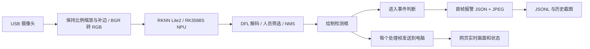

# Orange Pi 5 人员检测与网页报警系统

> 归档状态：已上传电脑端、报警模块、转换脚本与完整流程说明。板端实际 main.py / detect_image.py 尚待收集；当前仓库不是完整可运行交付包，详见 board/README.md。

USB 摄像头采集图像，在 RK3588S NPU 上运行 YOLOv8n，通过局域网发送实时画面和人员进入事件，在 Windows 浏览器显示状态、当前画面和历史报警截图。

## 功能
- 无论是否有人，网页持续显示当前处理后的画面。
- 有人显示红色提示，无人显示白色提示，离线显示状态未知。
- 连续 3 帧有效检测确认进入；每次进入仅保存首次有效检测帧。
- 连续约 1 秒无有效检测后结束当前进入事件，重新进入可产生新事件。
- 多人不做身份跟踪：有人持续在场时，另一人进入不另建事件。
- 历史报警持久化为 JSONL 和 JPEG；实时画面只保存在接收端内存。
- Windows 启动脚本协调接收服务、浏览器和 SSH 检测进程。

## 项目流程

## 阅读顺序
1. [部署与启动](docs/DEPLOYMENT.md)
2. [实现原理与十阶段复刻流程](docs/PROJECT_GUIDE.md)
3. [测试记录与限制](docs/TEST_REPORT.md)
4. [资源清单与模型来源](docs/RESOURCES.md)
5. [接口与故障排查](docs/API_AND_TROUBLESHOOTING.md)

## 目录
- `board/`：已整理的开发板报警模块，主程序待补；`main.py` 持续运行，`alarm.py` 负责画面发送和事件判断。
- `pc_receiver/`：Windows 接收服务、网页、便捷启动脚本。
- `conversion/`：官方模型转换脚本及实际转换环境锁定清单。
- `models/`：模型获取说明及校验值。公开仓库不包含模型二进制。
- `docs/`：完整中文复刻文档。

## 验证状态
基础 NPU 推理、静态检测、摄像头连续检测、报警接收和截图上传已由用户运行验证。最终实时网页与一键启动迭代的性能没有独立完整测试记录。用户于 2026-11-23 补充确认：30 分钟连续运行测试已完成，运行正常。网络中断恢复没有独立验证记录。

本项目用于可信局域网学习演示，网页没有登录鉴权；不应直接暴露到公网。第三方代码、模型与依赖许可见 [资源说明](docs/RESOURCES.md)。
